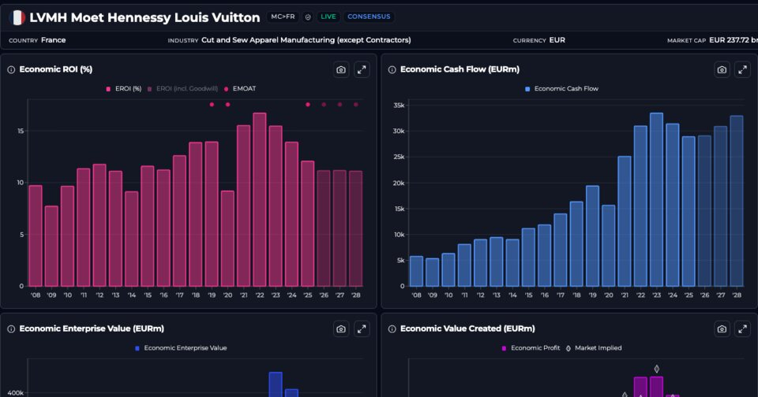
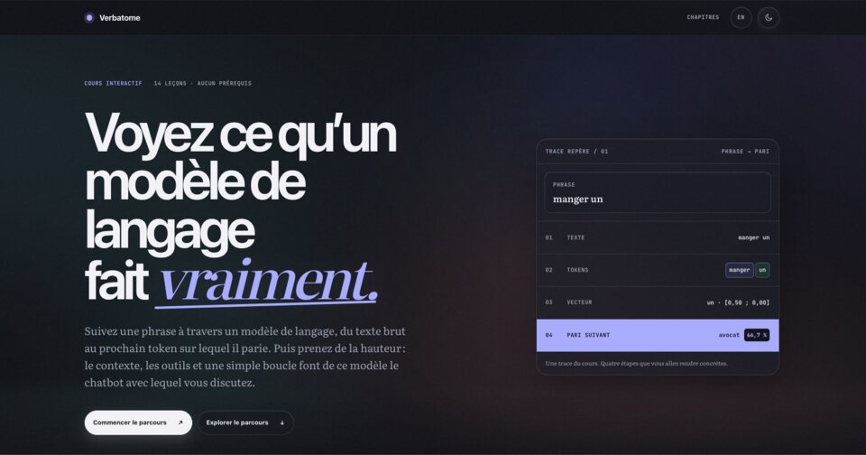
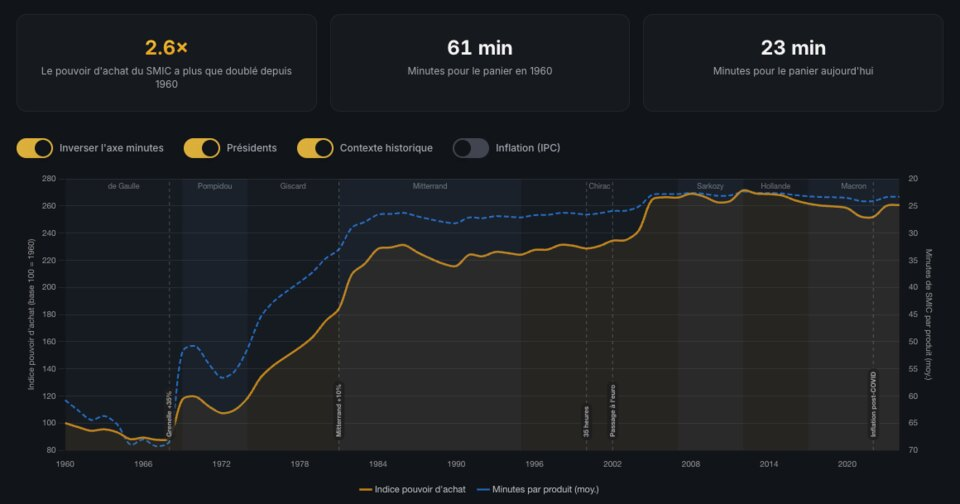
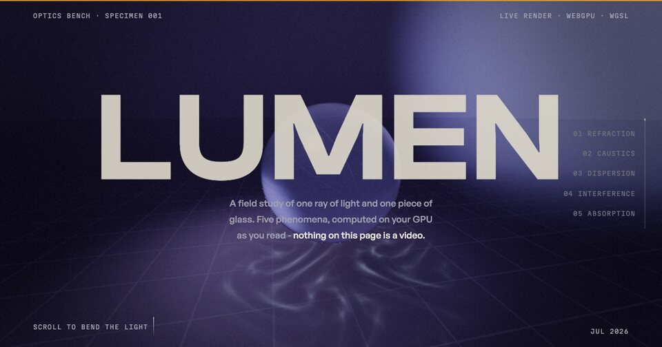
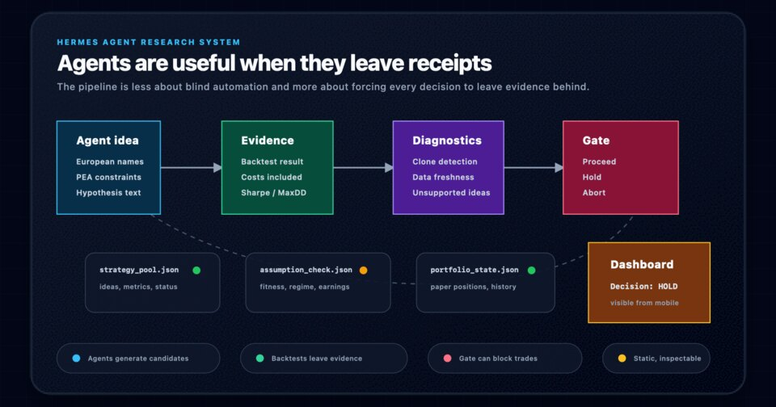
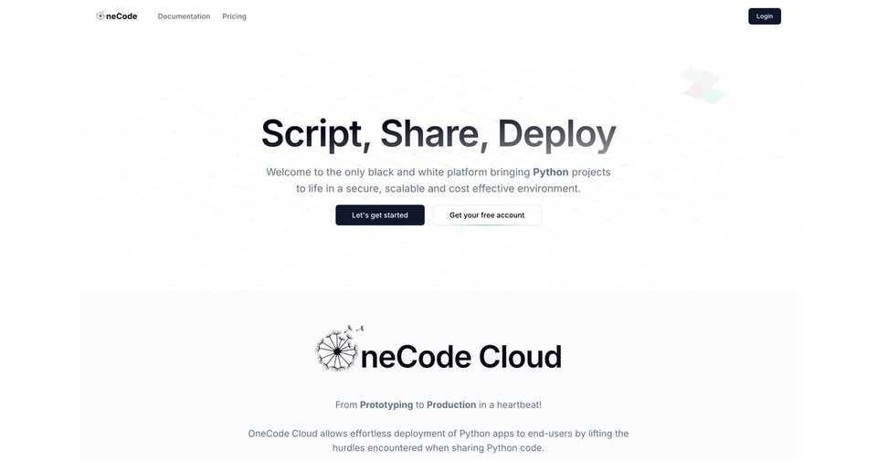

Software engineer building autonomous systems for quantitative research, data visualization, and web applications. Systems that show their work.

Paris · [Projects](https://romaincoupey.com/projects/) · [Writing](https://romaincoupey.com/posts/)

### Selected work

<table>
  <tr>
    <td width="50%" valign="top">
      
       
      <b><a href="https://romaincoupey.com/projects/omaha-insights/">Omaha Insights</a></b> · lead developer
       
      A finance analytics web app for KPI monitoring, peer comparison, valuation work, and investment screening.
    </td>
    <td width="50%" valign="top">
      
       
      <b><a href="https://romaincoupey.com/projects/verbatome/">Verbatome</a></b> · solo
       
      14 interactive lessons that follow text through a language model to a next-token prediction.
    </td>
  </tr>
</table>
<table>
  <tr>
    <td width="50%" valign="top">
      
       
      <b><a href="https://romaincoupey.com/projects/en-minutes/">En Minutes</a></b> · solo
       
      French prices turned into minutes of work, with historical data and the methodology in view.
    </td>
    <td width="50%" valign="top">
      
       
      <b><a href="https://romaincoupey.com/projects/rendering-experiments/">Rendering experiments</a></b> · solo
       
      Four framework-free pages: a WebGPU optics bench, a WebGL 2 pipeline tour, an article folded with HTML-in-Canvas, and a zine with no JavaScript.
    </td>
  </tr>
</table>
<table>
  <tr>
    <td width="50%" valign="top">
      
       
      <b><a href="https://romaincoupey.com/projects/autonomous-pea-research-pipeline/">Autonomous research pipeline</a></b> · solo
       
      An agent loop that screens European equities, backtests hypotheses with costs, and leaves an evidence trail at every stage.
    </td>
    <td width="50%" valign="top">
      
       
      <b><a href="https://romaincoupey.com/projects/onecode/">OneCode Cloud</a></b> · lead developer
       
      A cloud platform for deploying Python applications, built with Next.js and AWS serverless services.
    </td>
  </tr>
</table>

### Recent writing

<!-- posts:start -->
- [A fresh model found eight problems in a 72-line plan](https://romaincoupey.com/posts/fresh-model-eight-problems-in-a-plan/) · 22 Nov 2026
- [Nothing on this page is JavaScript](https://romaincoupey.com/posts/nothing-on-this-page-is-javascript/) · 13 Nov 2026
- [You can still select the text](https://romaincoupey.com/posts/you-can-still-select-the-text/) · 5 Nov 2026
- [The rendering pipeline, drawn by itself](https://romaincoupey.com/posts/notes-from-a-web-gl-and-css-experiment/) · 17 Jul 2026
- [Nothing on this page is a video](https://romaincoupey.com/posts/nothing-on-this-page-is-a-video/) · 14 Jul 2026
<!-- posts:end -->

[All posts](https://romaincoupey.com/posts/)

<picture>
  <source media="(prefers-color-scheme: dark)" srcset="https://raw.githubusercontent.com/Ngopimas/Ngopimas/master/images/snake-dark.svg">
  
</picture>

Last updated: 23 Nov 2026.
